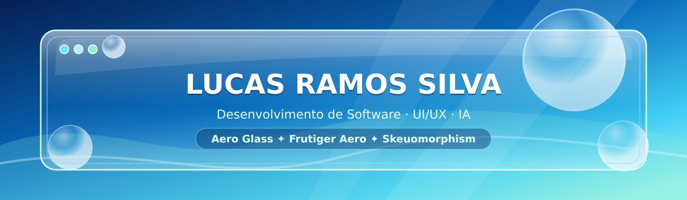

**🪟 Aero Glass • 🌿 Frutiger Aero • 💻 Engenharia de Software • 🤖 IA aplicada ao desenvolvimento**

---

## 💠 Sobre mim

Sou **Lucas Ramos Silva**, estudante do **3º ano do Ensino Médio integrado ao Técnico em Informática do IFPB — Campus Campina Grande**. Tenho paixão por transformar ideias em software: aplicações web, interfaces, ferramentas desktop e experimentos gráficos.

Quero seguir carreira como **arquiteto de software** e pretendo cursar **Engenharia de Computação no IFPB Campina Grande** ou **Ciência da Computação na UFCG**. Estou construindo meus fundamentos de programação, projeto de sistemas e engenharia de software, passo a passo.

- 🎨 **Design:** gosto de *skeuomorphism evoluído*, Windows 7 Aero e Frutiger Aero — vidro, reflexos, volume, luz e usabilidade.
- 🧠 **Aprendizado:** tenho boa afinidade com lógica de programação e continuo aprofundando frameworks e conceitos avançados.
- 🤖 **IA:** exploro ferramentas e técnicas de desenvolvimento assistido por IA para prototipar, estudar e aumentar a produtividade.
- 🔎 **Método:** trabalho por iterações, revisando o que construo e buscando melhorar qualidade, organização e desempenho.
- 🛠️ **Experiência:** já trabalhei em projetos com aproximadamente **10 mil a 50 mil linhas de código**, inclusive com assistência de IA. Ainda estou desenvolvendo autonomia técnica em sistemas maiores.

> **Minha filosofia:** criatividade para começar, lógica para estruturar e aprendizado contínuo para melhorar.

---

## 🌊 Projetos em destaque

### 🪟 [Systalia Glass Engine](https://github.com/LucasRamosSilva-15/systalia-glass-engine)

Compositor Wayland e shell gráfica experimental para Linux, com **Qt Quick**, renderização via **Vulkan** e materiais ópticos **VALO**. Pesquisa de interfaces desktop com refração, profundidade e efeitos de vidro.

    

> 🚧 Experimental e em desenvolvimento; não é ainda um ambiente desktop pronto para produção.

### 🌱 [WebFarm 2.0](https://github.com/LucasRamosSilva-15/Projeto_WEBII_WebFarm)

Plataforma full-stack para gestão agropecuária, reunindo propriedades, animais, lavouras, maquinários, equipes e controle financeiro. Inclui API REST, documentação e testes.

   

[Ver aplicação](https://projeto-webii-web-farm.vercel.app) • [Ver código](https://github.com/LucasRamosSilva-15/Projeto_WEBII_WebFarm)

### 💬 [SkyRipple — WebChat](https://github.com/LucasRamosSilva-15/WebChat)

Plataforma de comunicação em tempo real para web e Android, com salas, conversas privadas, autenticação e recursos de personalização. Experimento de full-stack e identidade visual inspirada no Web 2.0 Gloss.

   

---

## 💻 Tecnologias que utilizo e estudo

**Web e interfaces**

      

**Back-end e dados**

    

**Desktop, computação gráfica e ferramentas**

     

**Nota:** utilizar uma tecnologia em um projeto não significa dominá-la. Estou aprofundando especialmente **Node.js, React, Tailwind CSS, Next.js e Django** e minha capacidade de programar de maneira mais autônoma.

---

## 🤖 IA como ferramenta de aprendizado e produtividade

Exploro **ChatGPT, Gemini, Google Antigravity IDE e Stitch**, além de práticas como engenharia de prompts, decomposição de problemas, contextualização de tarefas, prototipagem assistida e ciclos de revisão.

Uso IA para acelerar experimentos e dar vida às minhas ideias, procurando **entender, testar e melhorar** os resultados em vez de apenas aceitar código gerado.

   

---

## 📊 GitHub em números

> Os cartões dependem de serviços externos e podem apresentar instabilidade temporária. As linguagens refletem o código dos repositórios, não um nível de domínio pessoal.

---

## 🎯 Próximos passos

- 🎓 Cursar **Engenharia de Computação (IFPB-CG)** ou **Ciência da Computação (UFCG)**.
- 🏗️ Evoluir em arquitetura de software, algoritmos, testes e manutenção de sistemas.
- 🌊 Explorar um **skeuomorphism evoluído** inspirado no Windows Aero e no Frutiger Aero.
- 🧩 Equilibrar criatividade, produtividade com IA e conhecimento técnico independente.
- 🚀 Criar projetos cada vez mais sólidos, utilizáveis e bem documentados.

---

### 🌤️ Vamos construir algo interessante?

<!-- Acrescente LinkedIn, site e e-mail aqui quando decidir quais links divulgar. -->

**Criatividade para imaginar. Lógica para construir. Curiosidade para evoluir.**

